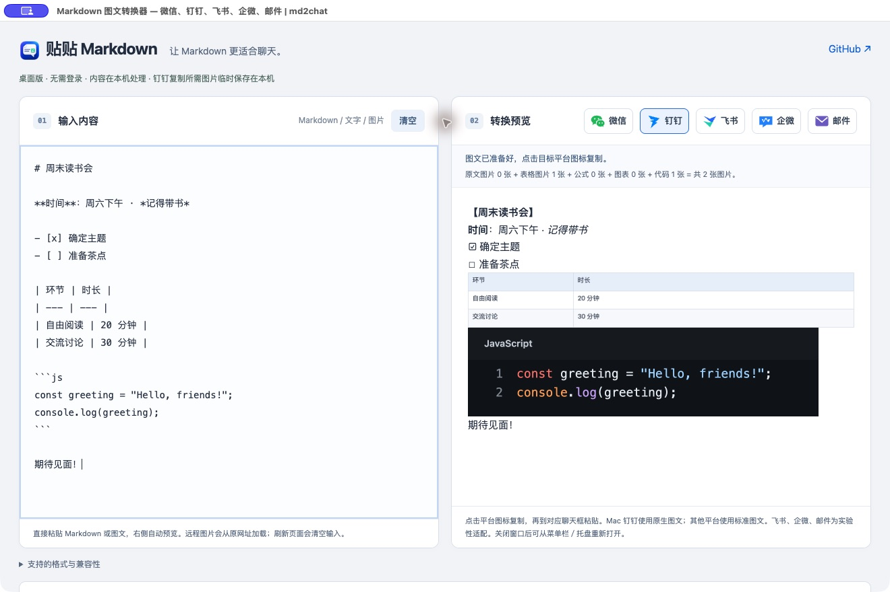

# md2chat · 贴贴 Markdown

让 Markdown 更适合聊天。保留可编辑文字，把表格、代码、公式和 Mermaid 转成图片，再按原文顺序组合。

- [产品主页](https://forgeturl.github.io/md2chat/)
- [最新版本与更新说明](https://github.com/forgeturl/md2chat/releases/latest)
- [网页版](https://forgeturl.github.io/md2chat/editor.html)
- [兼容性与测试范围](docs/compatibility.md)



## 下载最新桌面版

| 系统 | 安装包 | 备用归档 |
| --- | --- | --- |
| Windows x64（Intel / AMD） | [下载安装程序 EXE](https://github.com/forgeturl/md2chat/releases/latest/download/md2chat-windows-x64-setup.exe) | — |
| macOS Apple Silicon（M 系列） | [下载 DMG](https://github.com/forgeturl/md2chat/releases/latest/download/md2chat-mac-arm64.dmg) | [下载 ZIP](https://github.com/forgeturl/md2chat/releases/latest/download/md2chat-mac-arm64.zip) |
| macOS Intel | [下载 DMG](https://github.com/forgeturl/md2chat/releases/latest/download/md2chat-mac-x64.dmg) | [下载 ZIP](https://github.com/forgeturl/md2chat/releases/latest/download/md2chat-mac-x64.zip) |

链接始终指向最新发布版本，无需查找版本号。[版本说明](https://github.com/forgeturl/md2chat/releases/latest) · [SHA256 校验值](https://github.com/forgeturl/md2chat/releases/latest/download/SHA256SUMS.txt)。Windows ARM 暂无原生包。

## 桌面版

提供 Windows x64、macOS Apple Silicon 和 Intel 安装包。使用 Electron，应用内包含转换器和原生剪贴板能力，不需要另装插件、Python、Node 或助手。

输入 Markdown（左侧「清空」可重新开始）→ 检查右侧预览 → 点击「转换并复制完整图文」→ 在聊天输入框按一次 ⌘V / Ctrl+V。普通文字仍可编辑，图片能否保留取决于客户端兼容性。

安装包目前**未完成平台开发者签名（macOS 也未公证）**，系统可能提示或阻止打开。macOS 使用钉钉原生图文格式，已在 M 系列 Mac 的钉钉输入框验证；Windows 使用标准 HTML 图文，尚未适配和验证 Windows 钉钉专有格式，可能丢图。Intel Mac、微信等客户端未完成同等粘贴验证。不支持自动发送消息。

## 隐私

- 不登录，不上传正文或图片到 md2chat 服务；转换逻辑在本机运行。
- 不持久化保存输入正文。桌面版将复制用图片缓存在应用本机目录，保留以支持退出后粘贴。超过 7 天后下次启动时清理；剪贴板仍含钉钉格式时暂缓清理。
- 引用远程图片会访问其原网址，网页版仍受 CORS 与来源访问权限限制。
- 排查按钮只展示格式、字节数与图片数量；不输出正文、媒体标识或文件路径。
- 帮助菜单打开 GitHub Releases 查看更新；本版没有后台自动更新。

## 开发

Node.js 22+。macOS 安装包在 macOS 构建，Windows 安装包在 Windows 构建；CI 自动分平台打包。

```sh
npm ci
npm run dev          # 宣传页及网页版：http://127.0.0.1:18768/md2chat/
npm run desktop      # 桌面编辑器
npm run check        # 语法与回归测试
npm run build        # GitHub Pages 静态站点
npm run desktop:test # macOS 原生剪贴板往返测试，结束后恢复原剪贴板
npm run desktop:dist:mac # M 系列和 Intel Mac 的 DMG / ZIP
npm run desktop:dist:win # Windows x64 安装程序 EXE
```

`desktop:test` 会临时写入测试剪贴板，请在不使用剪贴板时运行。单元测试不访问系统剪贴板。桌面层使用 Electron 44 原生格式 API，运行时版本锁定在 package-lock.json。

## 项目结构

- `index.html`、`assets/landing*.css`：产品宣传与下载页面。
- `editor.html`、`assets/app.js`：网页/桌面共用转换界面。
- `assets/chat-markdown.js`、`assets/renderers.js`、`assets/code-images.js`：解析与图片渲染。
- `desktop/main.cjs`、`preload.cjs`：隔离的桌面主进程与窄 IPC 接口。
- `desktop/payload.cjs`：受验证的图文数据、本地图片和钉钉剪贴板结构。
- `tests/`：纯逻辑、图片顺序、原生格式与缓存清理测试。

桌面渲染进程开启 sandbox、contextIsolation，关闭 Node 集成。只加载打包的本地界面，拒绝页面导航、嵌入 webview 和任意外部窗口；剪贴板 IPC 验证调用方和内容，不能让渲染器选择读写文件路径。

## 发布

推送 main 自动发布 Pages。发布桌面版时：

1. 更新 `package.json` 和 `package-lock.json` 的版本，以及 `docs/release-notes.md`。
2. 提交并推送代码，再推送同版本标签（例如 `v0.3.0`）。
3. `Desktop release` 自动在 macOS / Windows runner 上检查并打包。三个构建全部成功后，校验五个发行文件，生成 SHA256 校验值，上传到草稿 Release，再发布并设为 Latest。

README 与宣传页使用 `releases/latest/download/固定文件名`，新版本发布后自动下载新版。历史版本仍保留在各自的 Release。Latest 表示当前下载版本，不代表安装包已签名或所有聊天客户端已验证。手动运行 workflow 仅生成构建产物，不发布 Release。

当前流水线明确不进行开发者签名；接入合法签名证书和 Apple 公证凭据后才能发布正式签名版。不要在网站上宣称未验证的客户端已兼容。

示例只使用虚构内容，请勿提交工作消息、剪贴板原始样本或私人截图。MIT 许可证；第三方渲染库见 [THIRD_PARTY_NOTICES.md](THIRD_PARTY_NOTICES.md)。
